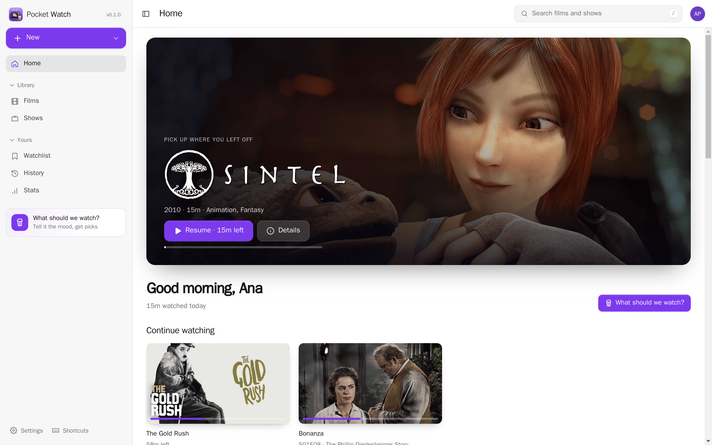
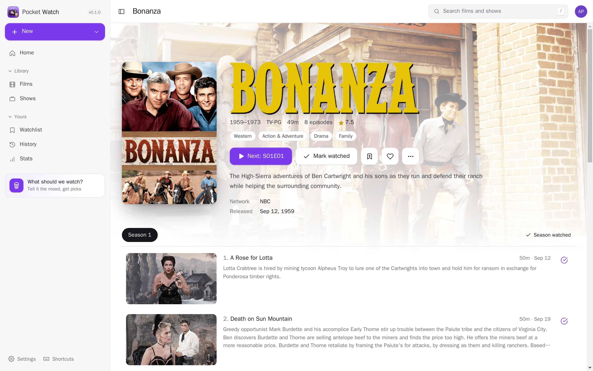
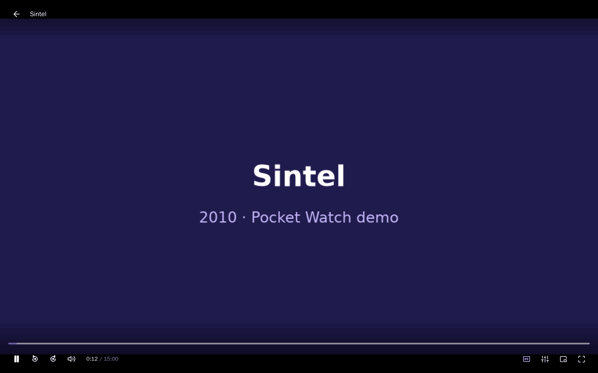
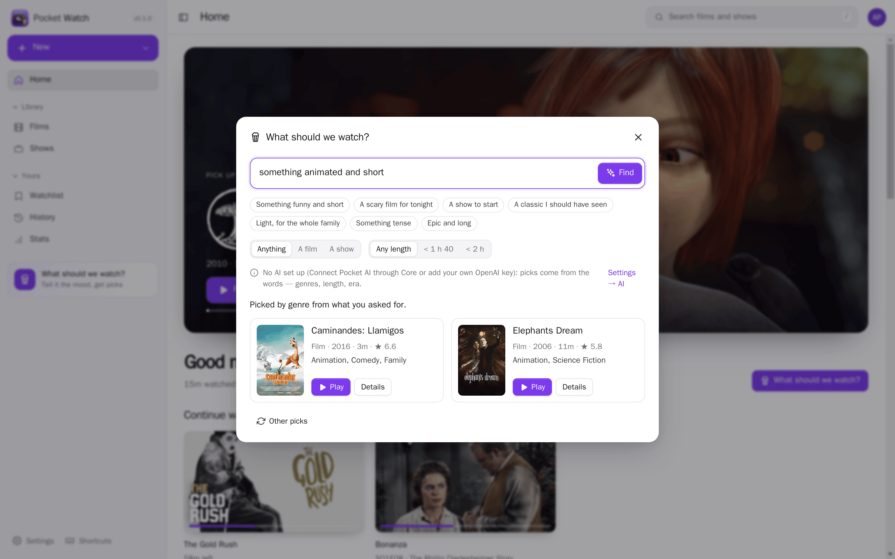
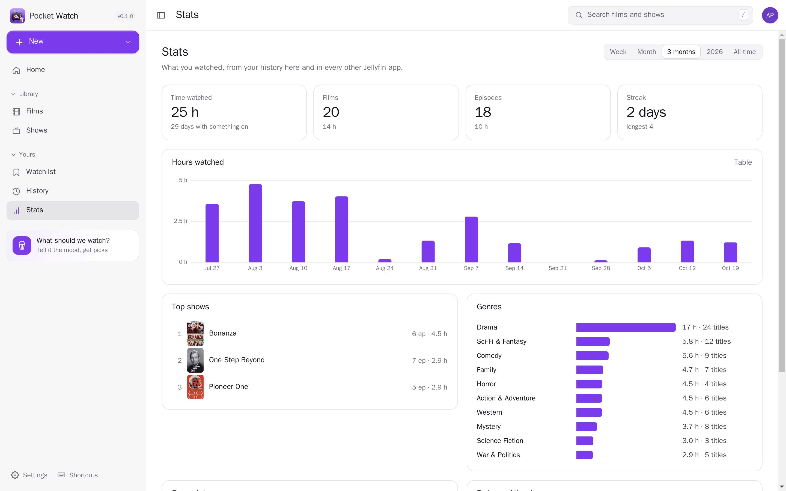
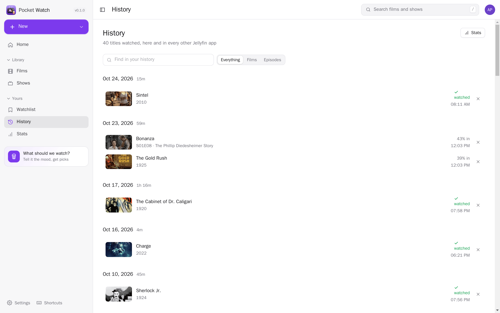
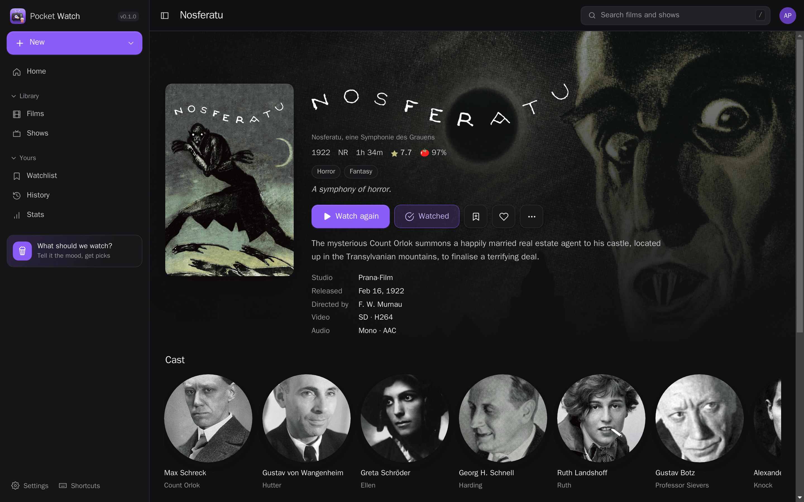
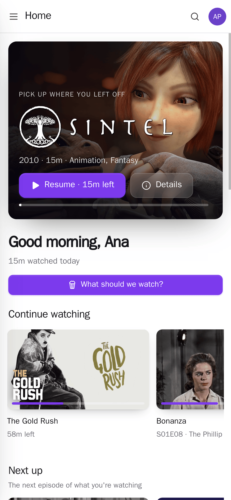
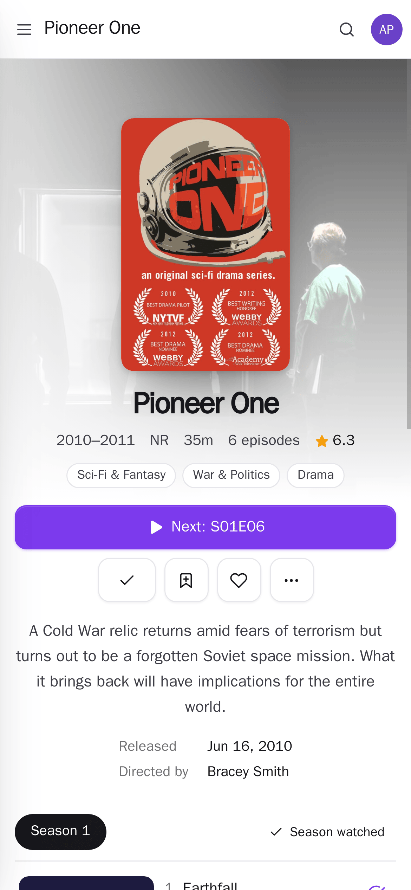

<p align="center"></p>
<h1 align="center">Pocket Watch</h1>
<p align="center">Films and shows for the whole household, on top of Jellyfin: a fast player, continue watching and next up, a watch history it keeps from every Jellyfin app with stats, a watchlist, Jellyseerr requests that tell you when they arrive, upcoming episodes, and “what should we watch?” from a sentence.<br>One Go binary, one SQLite file, one volume.</p>
<p align="center">
  <a href="https://github.com/abjelosevic88/pocket-homelab-watch/actions"></a>
  <a href="https://github.com/abjelosevic88/pocket-homelab-watch/pkgs/container/pocket-homelab-watch"></a>
  <a href="LICENSE"></a>
</p>

---

<p align="center"></p>

<table>
  <tr>
    <td width="50%"></td>
    <td width="50%"></td>
  </tr>
  <tr>
    <td align="center"><sub>Shows: seasons, episodes, what's next, watched marks that every Jellyfin app shares.</sub></td>
    <td align="center"><sub>The player: the file as it is when the browser can, HLS when it can't; subtitles, skip intro, next episode.</sub></td>
  </tr>
  <tr>
    <td width="50%"></td>
    <td width="50%"></td>
  </tr>
  <tr>
    <td align="center"><sub>“What should we watch?”: a sentence becomes picks from what you haven't seen.</sub></td>
    <td align="center"><sub>Stats from your history — here and in every other Jellyfin app.</sub></td>
  </tr>
  <tr>
    <td width="50%"></td>
    <td width="50%"></td>
  </tr>
  <tr>
    <td align="center"><sub>History, one row per title per day, wherever you watched it.</sub></td>
    <td align="center"><sub>Dark mode.</sub></td>
  </tr>
</table>

<p align="center">
  &nbsp;&nbsp;
  
</p>

## Why on top of Jellyfin

Jellyfin already does the server part very well — scanning, TMDB metadata and artwork, hardware transcoding,
subtitles, trickplay, and the API every TV, phone and Infuse speaks. Pocket Watch doesn’t replace any of that: it
plays your library *through* Jellyfin, with each person’s own account, and adds what the household around the films
needs — what everyone actually watched (on every device), what they want to watch, what they asked for and when it
arrived, what's coming next week, and help deciding on a Friday evening. Keep using Infuse or the TV app alongside:
resume points and watched marks are shared. More in [docs/design.md](docs/design.md).

## What it does

**Watching**
- Home: pick up where you left off, the next episode of every show you're on, new episodes and films, picks from
  your own shelves for today, “because you watched…”, what’s leaving soon.
- Films and shows with filters (unwatched, started, favourites, genre, decade) and sorting; a page for every film,
  show, season, episode and person, with cast, trailers and “more like this”.
- A player that plays the file as it is whenever the browser can (no transcoding), and asks Jellyfin for HLS when
  it can't; audio and subtitle tracks (text subtitles switch instantly, image ones are burned in), quality, chapters,
  seek previews (trickplay), skip intro and recap (media segments), the next episode with a countdown, picture in
  picture, the lock screen and keyboard shortcuts.
- Progress goes back to Jellyfin as you, every ten seconds — the TV picks up where the laptop stopped.
- **Pocket Homelab** on the phone plays through Pocket Watch too: it answers the Jellyfin API at `/jellyfin` with your Pocket Watch (or Pocket Core) token, so the phone never holds your Jellyfin login.

**Yours**
- A watch history Pocket Watch keeps: from its own player as you watch, and from every other Jellyfin app (read
  every few minutes), back to everything you had finished before. Stats: time watched, films and episodes, top
  shows, genres, when in the week and the day, streaks; a weekly recap if you want one.
- A watchlist across the library and what isn't here yet — one click from a request.

**Asking for more** (with Jellyseerr, Sonarr and Radarr)
- Discover what's trending and coming, search every film and show, request films or chosen seasons as your own
  Jellyseerr user; a push when it's ready to watch.
- Upcoming: the next episodes of the shows you watch and the films you asked for, day by day.

**What should we watch?**
- Say what you're in the mood for. With AI (Pocket AI, or your own OpenAI-compatible key) the picks come with a line
  each; the AI only sees unwatched titles' names, years, genres and lengths — never your history. Without AI the
  words still pick genres, length and era.

**Part of the Pocket apps** (with [Pocket Core](https://github.com/abjelosevic88/pocket-homelab-core))
- One sign-in; each person’s Jellyfin login can come from Core — nothing to paste.
- Pocket Day can write “what you watched” into your journal (`watching:read`); other apps can put titles on your
  watchlist or request them (`requests:write`); events for finished titles, requests and arrivals.
- Admins get “Out of sync?” in the player, straight to [Pocket Subtitles](https://github.com/abjelosevic88/pocket-homelab-subtitles)' nudge page.
- Strictly per person: history, watchlist, requests and settings are yours; admins don’t see anyone else’s watching.

## Run it

```sh
docker run -d --name pocket-watch -p 8080:8080 -v ./data:/data \
  -e BASE_URL=https://watch.example.com -e SECURE_COOKIES=true \
  -e JELLYFIN_URL=http://jellyfin:8096 \
  ghcr.io/abjelosevic88/pocket-homelab-watch:latest
```

Open it, create the first account, then sign in to Jellyfin under Settings → Jellyfin (password or Quick Connect).
An admin adds Jellyseerr, Sonarr and Radarr under Settings → Services. See
[docs/configuration.md](docs/configuration.md) for every option, [docs/api.md](docs/api.md) for the API (and a
Homepage widget), [docs/reverse-proxy.md](docs/reverse-proxy.md) and [docs/backup.md](docs/backup.md).

Try it with a demo library: [scripts/demo-library/make.sh](scripts/demo-library/make.sh) runs a throwaway Jellyfin
with Blender open movies, silent-era public-domain films and three old or Creative Commons series (generated
stand-in files, real metadata). The screenshots above are that library (credits in
[CREDITS.md](scripts/demo-library/CREDITS.md)).

## Built with

Go, chi, SQLite (modernc), React 19, Vite, hls.js. Works with Jellyfin 10.9+ (media segments need 10.10); works
alone, and with [Pocket Core](https://github.com/abjelosevic88/pocket-homelab-core) for single sign-on, paired phones
and the links between apps. MIT licensed.
